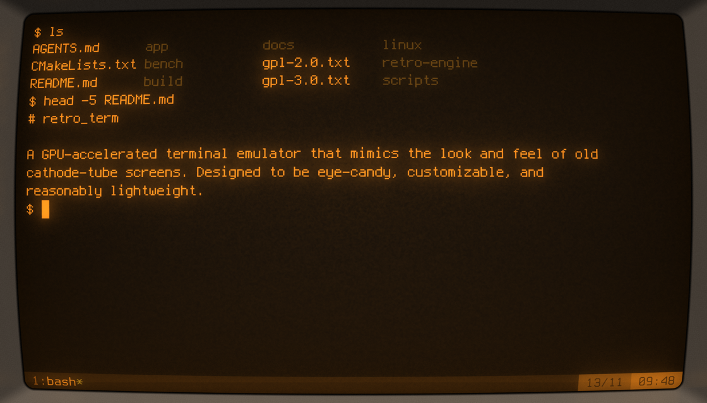
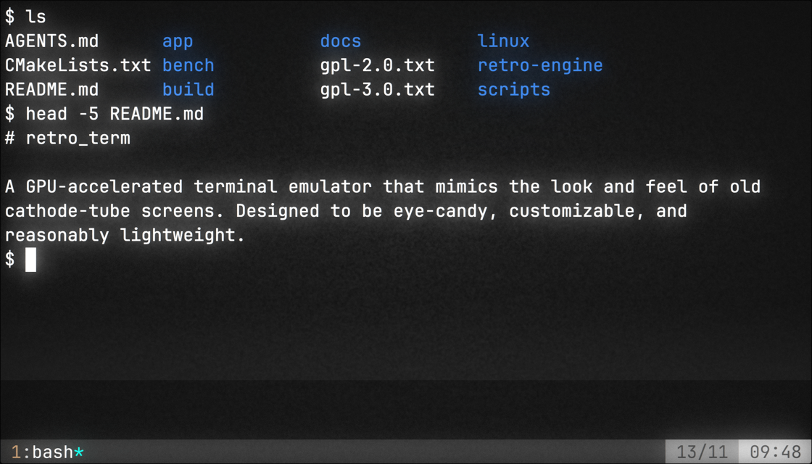
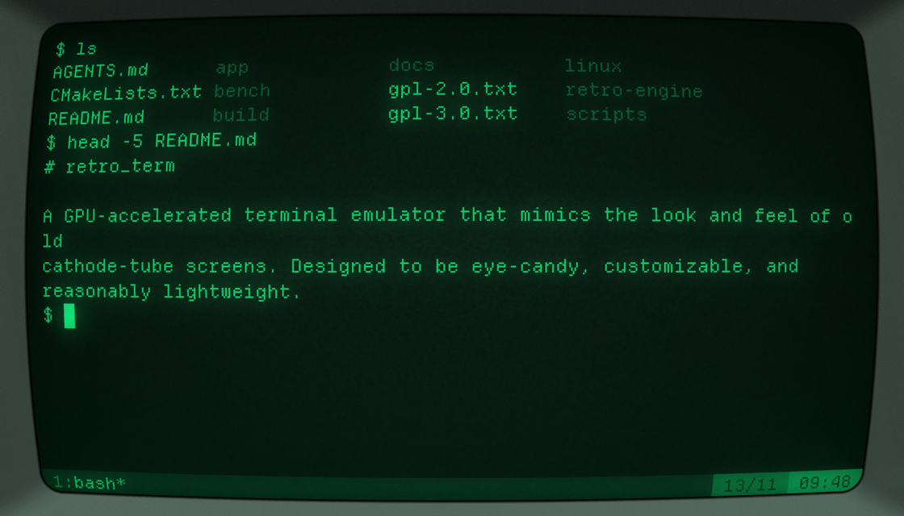
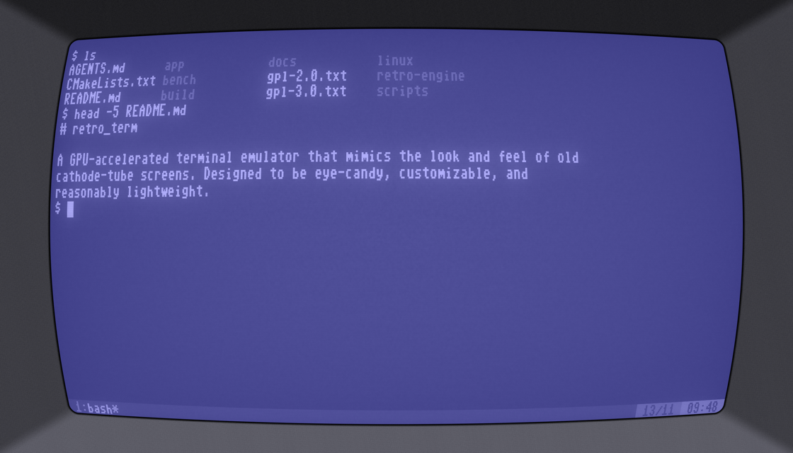

# retro_term

A GPU-accelerated terminal emulator that mimics the look and feel of old
cathode-tube screens. Designed to be eye-candy, customizable, and
reasonably lightweight.

  
  
  
  

## Features

- **CRT effects**: scanlines, screen curvature, bloom, burn-in, flicker,
  jitter, static noise, RGB shift, and a reflective bezel.
- **Profiles**: built-in looks (Amber, Green, Apple ][, Commodore 64,
  IBM VGA, and more) plus your own, with import and export.
- **Color schemes**: Solarized, Tango, Ubuntu, and other bundled palettes.
- **Fonts**: bundled retro bitmap fonts (Terminess, PetMe, Fixedsys
  Excelsior, IBM VGA, and others) and modern Nerd Fonts, or any system font.
- **Tabs, split panes, and multiple windows** with a tmux-style prefix key
  and customizable shortcuts.
- **Session restore**: tabs, split layout, and scrollback come back after
  a relaunch.
- **Modern terminal features**: clickable hyperlinks, search, prompt-to-prompt
  navigation, desktop notifications, progress bars, inline images (Sixel,
  Kitty, iTerm2), clipboard access, Kitty keyboard protocol, and
  synchronized output.
- **Runs on macOS and Linux**.

## Credits

retro_term began as a fork of
[cool-retro-term](https://github.com/Swordfish90/cool-retro-term). Its terminal
engine is derived from KDE Konsole and is maintained independently of upstream.
